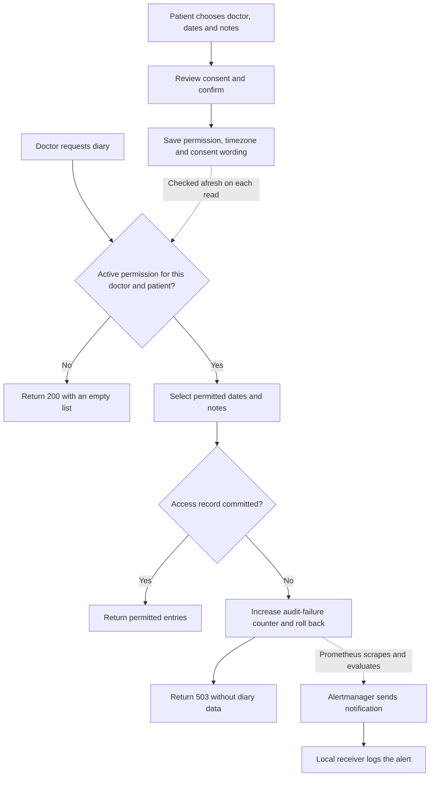
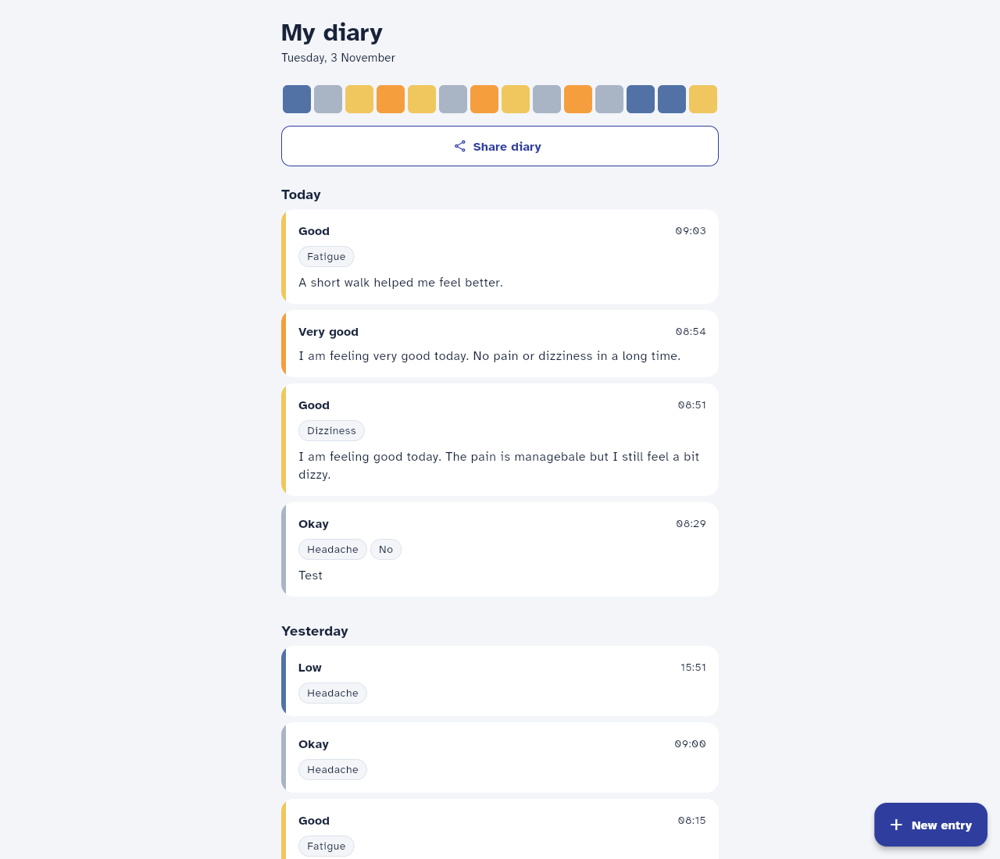
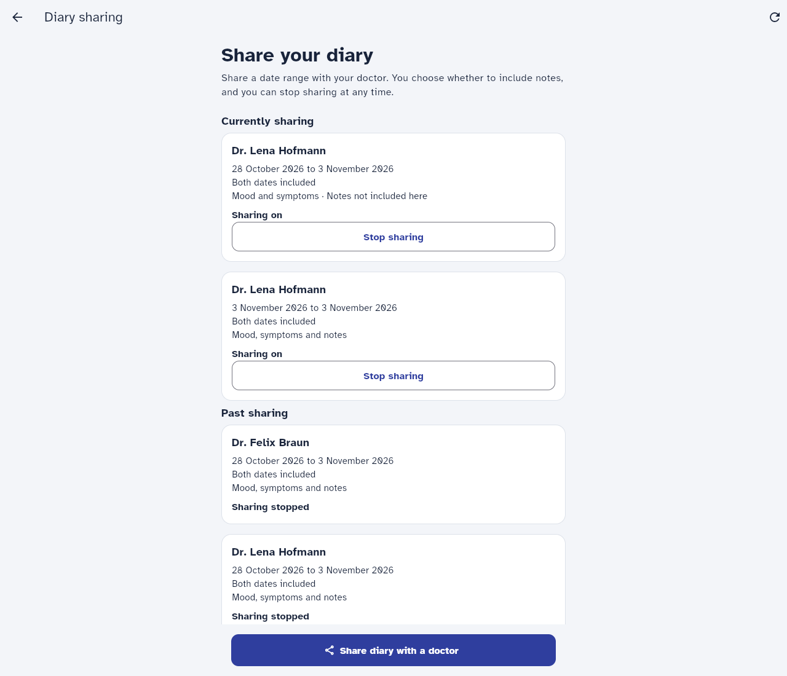
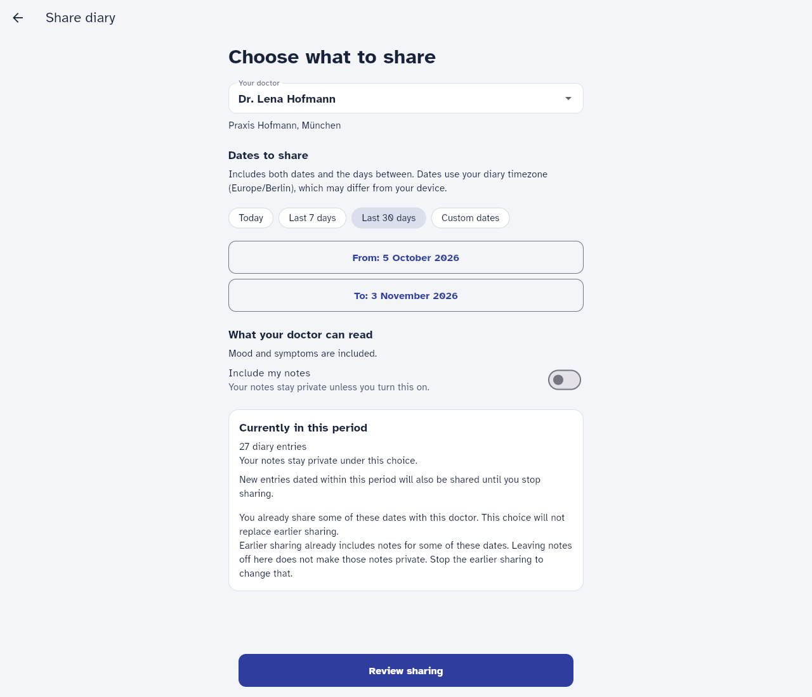
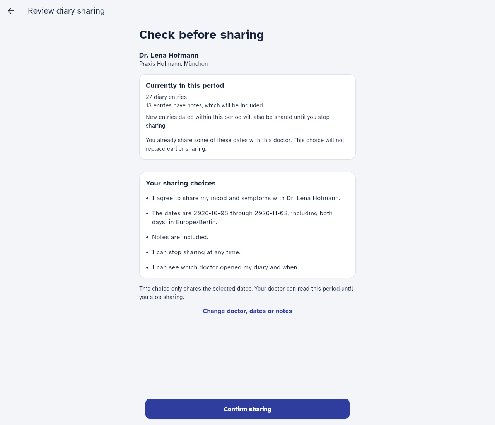
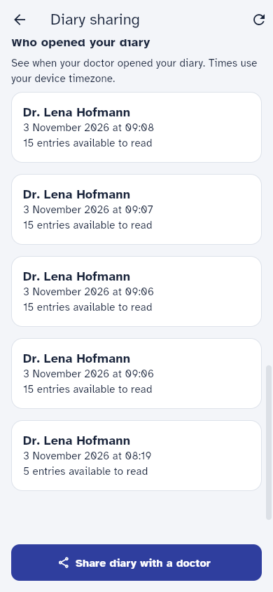
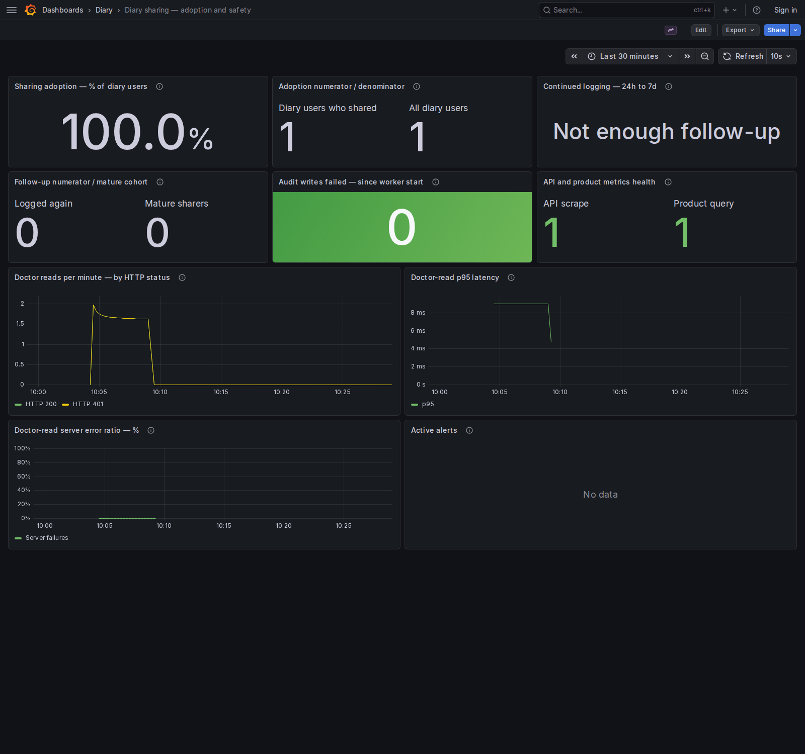

# Notes

Time spent: 2 hours on implementation, excluding setup. These notes were written afterward.

## What works

Patients can share selected diary days with a doctor, stop sharing and see who opened their diary. Notes stay private by default. Doctors read through the API; there is no doctor screen. Grafana shows product counts and doctor-read errors and latency. Alerts go to local logs.

The app still uses the supplied authentication stub. It does not check recent authentication or provide approved encryption or guaranteed ten-year retention. Erasure has not been implemented; the proposed approach is described below.

## How to check it

```sh
make up       # patient app: http://localhost:28001
make observe  # Grafana: http://localhost:28003
make test     # application, monitoring and rule tests
```

Choose a doctor with no other active permissions. Open Share diary, select dates containing entries, leave notes off, review and confirm. Then read as that doctor. This example uses doctor 1; change the token if needed:

```sh
curl -s http://localhost:28000/clinician/patients/1/entries \
  -H 'Authorization: Bearer clinician-1'
```

Refresh the app and reopen sharing to see the read history. Stop sharing and repeat the request. With no other permissions, the response is `200 []`. Other active permissions can still allow entries or notes. Each authorized request creates a history record, even if it returns no entries.

## Approach and scope

I separated patient actions from doctor access, then checked both against the privacy, compatibility and monitoring requirements. These were the functional and non-functional requirements. I followed the contracts in `API.md`, the security rules in `REQUIREMENTS.md` and the screen guidance in `app/DESIGN.md`.

| Area | Requirement and source | Scope |
| --- | --- | --- |
| Patient actions | Choose a doctor and inclusive dates, share, stop sharing, and see read history. Brief and API. | Required |
| Doctor access | Return only permitted entries; notes stay private unless included. Brief, API, O.Cons_1. | Required |
| Consent | Show the recipient, data and dates before confirmation; save the wording agreed to. O.Purp_1, O.Cons_3. | Required |
| Dates and compatibility | Use patient-local days, handle old `app-v1` timestamps, and keep `/entries` and `/me` response fields unchanged. Brief. | Required |
| Privacy and failures | Hide patient existence from unauthorized doctors, record access, avoid sensitive logs, return safe errors, and alert on recording failures. Brief, O.Log, O.Err_1, O.Mon_1. | Required |
| Product and operations | Measure sharing use, continued logging and doctor-read problems. README and brief. | Required |
| Erasure | Describe how deletion would work without ignoring the retention conflict. Brief. | Design required; code optional |
| Dashboard | Show the selected signals in Grafana. README. | Optional; included |

## Implementation milestones

### 1. Patient consent management

I started with the permission checked by the doctor endpoint. Once saved, it keeps the consent wording and timezone even if the profile or template changes later.

### 2. Doctor access and patient read history

Next I tested what a doctor could receive when permissions overlap, after withdrawal and for old timestamps. I checked these rules at the API before connecting the app. The access records also provide the patient's read history.

### 3. Patient sharing screens

I connected the screens and checked the browser flow, including failed saves. I also asked the agent to change the controls and wording; those changes are described under AI use.

### 4. Product signals, alerts and dashboard

I added monitoring last. Product counts come from saved shares and entries. I connected the tested failure counter to an alert rule and a local notification receiver, kept the dashboard and removed the extra monitoring features.

## Assumptions and open questions

### Choices where the task leaves room

- Permissions can cover a single day or future dates. The dates determine which entries are shared. A permission stays active until stopped and can cover entries added later for those days.
- When permissions overlap, each entry appears once. Its note is included if any active permission covering that entry allows it.
- Withdrawal keeps the permission record and its first withdrawal timestamp. Repeated requests are safe. Unknown permissions and permissions owned by another patient both return 404.
- Authorized reads are recorded even when they return no entries. Reads without permission are not recorded. Nonexistent patients and patients without permission both return `200 []`.

I added `GET /sharing-context` and `POST /sharing-preview` alongside the original task endpoints. They provide consent information in the saved timezone, current counts and overlap warnings without changing `/me` or `/entries`. A preview saves neither a permission nor an access record.

### Questions and limits

- Should a permission expire after an appointment? There is no expiry field in the contract, so no automatic expiry was added.
- Where should the 15-minute reauthentication check happen? The requirement applies, but the stub cannot perform it.
- A read already in progress may finish after withdrawal. Concurrent scheduling was not tested.
- `app/lib/format.dart` displays entries in the device timezone. Sharing uses the saved patient timezone and treats `app-v1` timestamps as local wall-clock times. These rules can place an entry on different days. For example, `2026-09-30T22:30Z` is October 1 in Berlin but appears as September 30 on a UTC device. This leaves the brief's requirement to share the days patients see in their diary partly unmet.
- The app shows previously fetched consent wording, recipient details and timezone. The server uses current values when saving a share. If those values change between review and confirmation, the saved consent or disclosure period can differ from what the patient saw. The server does not reject stale confirmations.
- A timed-out create request can produce duplicates on retry.
- Identical response bodies/statuses do not prove protection against timing clues.

## Data model decisions

`backend/app/models.py` adds two tables through migration `0002_diary_sharing.py`:

- DiaryShare stores the patient, doctor, inclusive dates, notes permission, saved timezone, resolved consent wording/version, creation time and withdrawal time. A database constraint rejects reversed dates. Withdrawal updates the record and keeps it.
- DiaryAccess stores the patient, doctor, access time, entry IDs, note-entry IDs and permission IDs. The IDs identify the data selected for disclosure; the record contains no diary text. It does not prove that the network delivered the response or that a human read it.

Migration `0003_protect_access_records.py` rejects ordinary UPDATE and DELETE. Its retention limits are in the requirements table. ID arrays do not automatically delete access evidence when diary rows are removed.

For modern entries, `access.py` compares calendar dates in the permission's saved timezone, including daylight-saving changes. For `app-v1`, it uses the stored wall-clock date without another shift. Stored and returned timestamps are unchanged. Ordering mixed legacy/modern entries is approximate because some original instants are unknown.

### Sharing and doctor-read flow

To satisfy O.Log_1, I chose to commit the access record before returning diary entries. If that write fails, the API returns 503 without the entries. The API checks the user's role before this flow begins.



Alert delivery happens separately from the API response and requires the monitoring stack to be running.

## Requirements

Unless a full path is given, backend code is under `backend/app/` and backend tests are under `backend/tests/`. All access checks rely on the starter authentication stub.

| ID | Applies? | Where it is met (code, test), or why not |
| --- | --- | --- |
| O.Purp_1 | Yes | `app/lib/share_form_screen.dart` shows doctor, categories, inclusive dates and timezone before confirmation. `app/test/sharing_test.dart` checks both notes choices and that no share is created before confirmation. |
| O.Cons_1 | Yes | `access.py` checks active patient/doctor permissions, dates and notes. `test_access.py` covers isolation, overlaps, revoked permissions, DST and legacy dates. The stale-consent gap can change the period from what was reviewed; full compliance is not claimed. |
| O.Cons_2 | Yes | `api.py` checks ownership and preserves the first withdrawal time. Every read queries current permissions. `test_shares.py` and `test_access.py` cover repeated withdrawal and a later read. In-progress reads may finish. |
| O.Cons_3 | Yes | **Partly met.** `consent.py` and `DiaryShare` store the resolved wording, version and timezone. `test_shares.py` checks saved evidence; Flutter tests check the displayed consent text. There is no check that the reviewed context still matches at creation, so saved wording is not guaranteed to be the wording approved. |
| O.Auth_1 | Yes | **Not met.** `auth.py` keeps the starter stub, which cannot prove identity or authentication age. Agree where the 15-minute reauthentication check belongs before adding real authentication. |
| O.Pass_1 | No password handling in this feature | The stub accepts bearer tokens; this change creates or checks no passwords. A real authentication system still needs the stated password rules. |
| O.Log_1 | Yes | `access.py` commits doctor/patient/time and exact entry, note and permission IDs before returning data. `test_access.py` covers repeated/empty reads and commit failure blocking disclosure. |
| O.Log_2 | Yes | `api.py` returns only the patient's access records, newest first. `app/lib/sharing_screen.dart` shows doctor and device-local time. Backend and Flutter tests cover history and isolation. |
| O.Log_3 | Yes | **Partly met.** Migration 0003 blocks ordinary UPDATE/DELETE; `test_access.py` tests both. Privileged changes, TRUNCATE, protected backups and ten-year retention are not covered. |
| O.Log_4 | Yes | `logging_config.py` allows fixed fields and generated request IDs; `main.py` logs route templates, not raw paths/bodies. SQL parameters are hidden and raw Uvicorn access logs are disabled. `app/nginx.conf` logs status/timing only. `test_logging.py`, `test_access.py` and `test_product_metrics.py` check sensitive input and bounded labels. The receiver drops arbitrary labels/annotations. Historical logs were not removed. |
| O.Mon_1 | Yes | **Local alert path provided.** `access.py` increases the failure counter; `observability/alerts.yml` evaluates it; Alertmanager routes to `receiver.py`. Backend tests cover the signal, rule tests cover evaluation, and a manual check verified firing/resolved delivery from Alertmanager. That check does not test the full application-to-Prometheus path. External paging and durable failure reporting remain gaps. |
| O.Err_1 | Yes | `main.py` returns generic 422/500 responses; audit failure returns a safe 503. `test_access.py` and `test_logging.py` inject failures and sensitive input. Nginx version tokens are hidden. Less validation detail is returned, without changing status codes. |
| O.Cryp_1 | Yes | **Not met or verified.** A Docker volume is not evidence of approved encryption. Database/backup encryption and key handling need security-officer approval and deployment evidence. |
| O.Del_1 | Yes; code optional | No deletion workflow was built. Proposed steps and the unresolved retention conflict are below. |
| O.Doc_1 | Yes | This table records applicability, code/test evidence and remaining gaps for every listed requirement. |

## Erasure (O.Del_1): how I would do it

1. Verify the request, stop sharing and block new disclosures while deletion runs.
2. Use a resumable job to remove diary entries, notes, profile data and identifiable derived data. Include exports and any caches or analytics copies.
3. Cover backups and restores: define backup expiry and reapply deletions after a restore so erased data does not return.
4. Resolve access-record retention with privacy/legal and clinical owners before deleting evidence. The brief asks for both total erasure and ten-year access records. Agree what must remain, why, for how long and who may access it. Reversible pseudonymization is not full erasure.

## Monitoring

Run `make observe`. Open the [sharing dashboard](http://localhost:28003/d/diary-sharing); the starter API overview remains available. Commands and manual notification checks are in [observability/README.md](observability/README.md).

### Product: review weekly

- Adoption: patients with entries who ever shared / all patients with entries.
- Continued logging: eligible sharers who created an entry between 24 and 168 hours after first sharing / eligible sharers. Eligible patients had an entry at or before first sharing and have at least 168 hours of follow-up.

The calculation uses server `created_at` so a backdated diary date does not affect it. Each patient counts once. Withdrawn permissions still count as trying sharing, and excluding the first 24 hours avoids counting immediate same-session logging. This measures first-week return. It does not measure three-month engagement or show that sharing caused patients to return.

The demo has one diary user and no eligible follow-up group, so it shows "Not enough follow-up". That does not mean 0% retention. Read percentages alongside counts. The figures describe current database populations and do not depend on the chart time picker. Imports and erasure can change them. If the aggregate query fails, counts are omitted and query health is set to 0.

### Operations: act on service failures

| Signal | Threshold and urgency | First action |
| --- | --- | --- |
| Access recording failed | Any failure; critical | Confirm disclosure stays blocked. Check DB connectivity, storage and permissions. Investigate before restarting. |
| Doctor-read server errors | More than 5% 5xx for 5 minutes, with at least 20 requests per rolling 5 minutes; critical | Check API/DB health and safe request-ID logs. |
| Doctor-read p95 latency | Above 2 seconds for 10 minutes, with the same volume guard; warning during clinic hours | Check DB latency, API load and diary sizes. |
| API unavailable | Scrape down or absent for 1 minute; critical | Check the API process, dependencies and scrape network. |

Counts and latency include authorization and empty responses. An empty `200` is not an error; sparse latency estimates are unreliable. A wrong day filter could still return a wrong list with `200`, so these signals cannot replace the date/permission tests. Scrape health also does not prove the clinician portal works.

Prometheus scrapes and evaluates rules every 5 seconds. Alertmanager waits 5 seconds before the first notification, repeats hourly and sends resolution notifications. Notifications go to local logs; no real pager is connected. The audit alert stays active until the worker restarts and also fires if the first scrape is nonzero. Restarting does not prove recovery. A crash before a scrape can lose the signal.

There are no patient/doctor metric labels or diary text. Known telemetry names have fixed labels; others count as `other`. `/metrics` remains unauthenticated. Loopback ports and anonymous Grafana admin are for the local demo. Small aggregate counts can still reveal information, so production needs restricted access and a small-group reporting policy.

## Checks run

The final review reran `make test`, `make lint`, `make app`, Compose configuration validation and the Alembic schema-drift check through Docker/Make in Ubuntu WSL.

- `make test`: 69 backend tests, 13 Flutter tests, 5 monitoring unit tests and 6 rule scenarios passed.
- `make lint`, Compose configuration validation and `git diff --check` passed.
- Migrations applied and the Alembic model/schema drift check passed. Ordinary access-record UPDATE/DELETE were rejected.
- Chromium checks covered sharing, doctor reads, read history, stopping sharing and a simulated save failure. Phone and desktop screens were inspected. Tap-target, label and contrast widget checks passed.
- Four live alert rules loaded. The documented manual Alertmanager check delivered firing and resolved notifications. All 13 dashboard queries passed; Chromium reported no page errors.
- `make app` passed. A build reported a CupertinoIcons font warning; the inspected icons rendered.

## Screenshots

These Chromium screenshots use synthetic local data. The 18 entries were added through the API, preserving the existing data and startup seeds. Browser checks left real read-history records and one active demo permission. Dashboard traffic includes synthetic empty reads and authentication errors. No old shares were fabricated to populate follow-up.








## How I used AI

I used the pi coding assistant to read the starter, write much of the code and tests, run checks, and help draft these notes. I reviewed the sharing rules and proposed work between milestones.

I wanted useful logs after sensitive output was removed, so I asked for shared configuration and log levels. Logs now use request IDs, fixed events and safe error categories.

On the first screens, I found the sharing action too small and the wording inconsistent. I asked for full-width actions, readable dates, "Stop sharing" and bullet-point consent matching the saved wording. Later, I asked it to remove the extra monitoring test services, inbox/history features, two alerts and dashboard banner.

Separately, widget/browser checks caught a refresh callback returning a Future, an unhandled preview error and a narrow button. The agent fixed those and a PromQL typo.

## Next steps

- Make the diary display use the same patient-timezone and legacy-date rules as sharing, without changing `/entries` or `/me` response fields. Add UI/API boundary tests, then rerun the manual sharing flow.
- Add real identity and recent-authentication checks, approved encryption and protected ten-year retention with the relevant owners.
- Connect external paging, secure monitoring access, make audit-failure reporting durable and monitor the notification system independently.
- Reject stale consent confirmations and require a fresh review if wording, recipient details or timezone changed. Preserve compatibility with existing API clients. Address ambiguous create retries.
- Measure query costs before moving date filtering into SQL or caching product aggregates; the aggregate currently has a two-second SQL timeout.
- Extend engagement checks beyond the first week and configure longer monitoring-history retention once enough follow-up exists.
- Agree the erasure/retention policy before building deletion.
